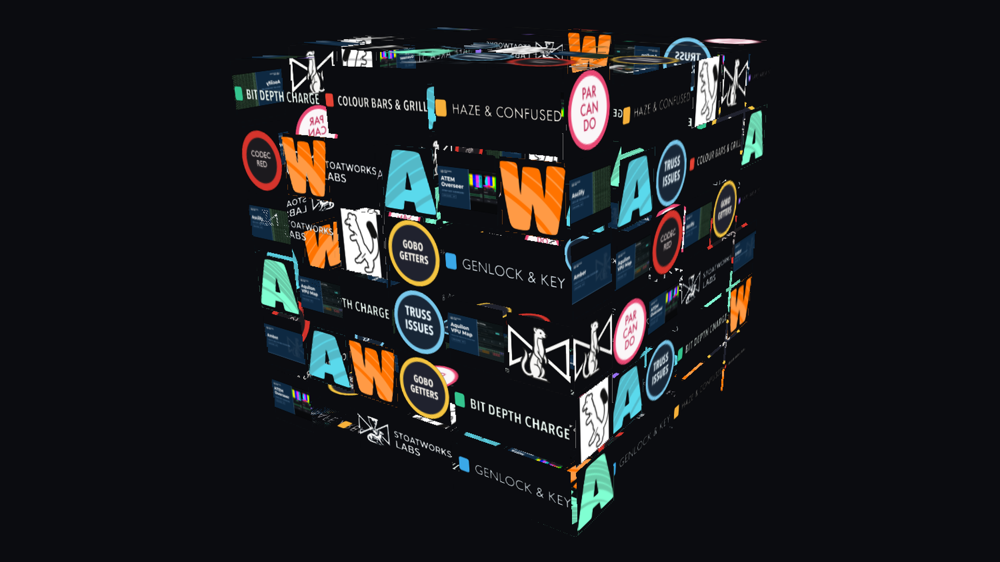

# Gridiron

> **AI-assisted project.** This codebase was created with [Claude](https://claude.com/claude-code)
> (Anthropic), directed and reviewed by a human author. The arrangement is
> **measured** rather than asserted: an offline harness builds real schedules and
> checks that every logo gets the same number of placements to the unit, that no logo
> touches a copy of itself, and that the same seed gives the same wall. The rendering's
> checked the same way, with a headless GL context driving the real plugin class against
> a real folder and counting pixels. **Other people are running it in Resolume, but no
> harness here reaches a real composition on real hardware** (see [Status](#status)).

An animated step-and-repeat: the sponsor wall you stand in front of to be
photographed, built from a folder of logos and given something to do.

Point it at a folder of logos and it fills a grid by the rules below, then
animates it: scrolling reels, twinkling cells, cells that fade and change logo,
or the whole wall wrapped onto a Rubik's cube that turns a slice at a time.

It's an FFGL source plugin for Resolume Arena and Avenue.



<sub>Rendered by the plugin's own offline harness rather than captured from Resolume. The logos are the demo pack that ships with the download: Stoatworks' own marks, a few project graphics, and a set of invented sponsors named after the trade: Colour Bars & Grill, Haze & Confused, Gobo Getters, Truss Issues. The Resolume product marks are Resolume's own, included as sample content only.</sub>

**[Try it in your browser](https://gridiron-demo.stoatworks-labs.com)**: the
plugin's own shaders in WebGL2, over a JavaScript port of the arrangement and
the layout, starting on the demo pack. Drop your own logos on it; they don't
leave the page. It's a port rather than the plugin, so have a read of what the
page says it doesn't reproduce.

<!-- downloads:start -->

## Download

**[v0.2.3](https://github.com/stoatworks-labs/gridiron/releases/tag/v0.2.3)** — prebuilt for macOS and Windows. Pick your platform:

<details>
<summary><b>macOS</b> — Universal (Apple Silicon + Intel)</summary>

| Build | Download | Size |
| --- | --- | --- |
| Universal (Apple Silicon + Intel) · .dmg disk image | [`gridiron-0.2.3-macos-universal.dmg`](https://github.com/stoatworks-labs/gridiron/releases/download/v0.2.3/gridiron-0.2.3-macos-universal.dmg) | 2.2 MB |
| Universal (Apple Silicon + Intel) · .zip archive | [`gridiron-macos-universal.zip`](https://github.com/stoatworks-labs/gridiron/releases/latest/download/gridiron-macos-universal.zip) | 2.2 MB |

</details>

<details>
<summary><b>Windows</b> — x64</summary>

| Build | Download | Size |
| --- | --- | --- |
| x64 · .exe installer | [`gridiron-0.2.3-windows-x86_64-setup.exe`](https://github.com/stoatworks-labs/gridiron/releases/download/v0.2.3/gridiron-0.2.3-windows-x86_64-setup.exe) | 2.0 MB |
| x64 · .zip archive | [`gridiron-windows-x86_64.zip`](https://github.com/stoatworks-labs/gridiron/releases/latest/download/gridiron-windows-x86_64.zip) | 2.0 MB |

</details>

All builds, checksums and release notes: [github.com/stoatworks-labs/gridiron/releases](https://github.com/stoatworks-labs/gridiron/releases).

macOS builds are signed and notarised and open normally. The Windows builds are unsigned, so SmartScreen warns once.

<!-- downloads:end -->

## Pointing it at a folder

**Pick any single image inside the folder.** Gridiron reads the directory around
it.

I'd have used a folder picker if there were one. FFGL's parameter types stop at
`FF_TYPE_FILE` (a *file* dialog), and there's no directory type in the
specification, so a folder picker can't be built. Picking any file inside the
folder is one click in the native dialog and needs no path typing. `Folder Override` takes a literal
path for anyone driving the plugin from a script.

Accepted: `png` `jpg` `jpeg` `gif` `bmp` `tga` `psd` `svg`. Animated GIFs play,
each frame for as long as the file says, with every copy on the wall in step.
Each frame is a texture layer the size of the folder's largest logo, so frames
share a 256 MB allowance; a GIF that won't fit in it is drawn as its first frame,
and the About line tells you so rather than leaving you to wonder.

## ⚠️ Convert text to outlines before exporting an SVG

**Live `<text>` in an SVG won't draw. At all.**

The vector parser has no font engine: no font loading, no glyph outlines, not
even a stub. An SVG whose wordmark is live text parses without error, reports no
failure, and draws nothing where the sponsor's name should be.

On a sponsor wall that's the worst thing that can happen, so gridiron counts the
dropped elements and says so in its About field. The fix is at export, though:

> Illustrator: select the text, **Type → Create Outlines** (⇧⌘O), then export.
> Inkscape: **Path → Object to Path** (⇧⌘C).

## How the wall is filled

Four rules, in this priority order when they conflict:

1. **Reproducible.** A seed fixes the arrangement. The same folder and seed give
   the same wall, across a reload, across a machine, and across the gap between
   the wall the client approved and the wall that goes up on the night. Shuffle
   the seed until you like one, then leave it.
2. **No adjacent repeat.** A logo never touches a copy of itself. This is what
   makes a small pack over a big wall read as designed rather than looped, and
   it's the first thing an eye picks out of a photograph. The control is
   **Vary Neighbours**, on by default. It doesn't promise every logo is
   unique (with fewer logos than cells it can't be), only that no two
   touching cells carry the same one.
3. **Equal airtime.** Every logo is on screen for the same total *time* per
   cycle: the same number of placements, each one step long, and a wordmark
   spread over two cells still counts as one. Sponsors pay for parity, and some
   of them count.
4. **Aspect-aware.** A long wordmark is given two cells rather than being
   letterboxed into one, and is never cropped in half.

Rule 2 beats rule 4 because a duplicated neighbour is visible from across a room
and a letterboxed logo isn't.

### Fit modes

| mode | what it does |
|---|---|
| **Fit** | whole mark visible, letterboxed. The safe default for a client's logo. |
| **Fill** | fills the cell, overflow cropped |
| **Trim margins** | discards the exported margin, then letterboxes |
| **Stretch** | distorted to the cell |

**Trim margins** is the one worth knowing about. Sponsor packs never have
consistent margins. One logo is exported tight to its bounding box, the next
sits in a square canvas with a third of it air, and dropped into identical cells
they read as wildly different sizes, which looks like a mistake by whoever built
the wall. Trim measures where the opaque pixels actually are and normalises
every mark to the same *optical* size.

It letterboxes rather than filling, on purpose. Filling after a trim is what
**Fill** already does, and on a wordmark it scales until the name runs off both
sides of the cell, so "COLOUR BARS & GRILL" comes out as "FE ARJR BARE & CO".

## Modes

- **Static:** a wall.
- **Slot Machine:** each column is a reel at its own speed, decelerating to a
  stop. The travel is a whole number of cells, so a reel can't land out of
  alignment: the landing is exact by construction, not snapped at the end.
- **Rubik:** the wall wrapped onto a cube, one slice turning at a time. The
  sequence is a scramble followed by its own inverse, so it returns to a solved
  cube and loops without a jump.
- **Twinkle:** every cell at a different point between full brightness and
  black. The phases are hashed per cell, so nothing pulses in lockstep.
- **Fade Cycle:** cells fade out and in, changing logo while they're dark.

On top of any of them: whole-grid scroll and rotation, logo walk (content moving
*through* the grid while the cells stay put), a visible grid, and a hero block at
top, middle or bottom for the headline sponsor or the event name.

## Edge treatments

Gridiron has the three line-art looks from the fleet, **Burin** (engraved),
**Nib** (inked contour) and **Vectrix** (traced), and applies them to the whole
wall, to every logo individually, to the hero only, or to everything except the
hero.

Per-logo is the reason these are built in rather than left to the Resolume
chain: hero solid, everything else line art, isn't something you can get by
stacking a plugin on top.

## Browser demo

**<https://gridiron-demo.stoatworks-labs.com/>** runs the wall shader and the
composite, spliced unedited from `source/Shaders.cpp` into `demo/shaders.js`
(`demo/tools/check_shaders.py` fails `tools/verify.sh` on a changed character).
Everything that decides what they draw is a JavaScript port in `demo/port.js`:
the folder rules, the trim, the atlas geometry, `Fill.cpp`, `Layout.cpp` and
the mappings. `demo/tools/crosscheck/` holds the port to the C++ and verify runs
it: every atlas plan, every schedule and every cell's logo identical, every
position within a millionth. It also holds the plugin's arm64 build to its x86_64
arithmetic within a hundredth, which is how the cube bug below was found and how
it stays fixed. With `--frames` it also renders the real plugin class and the
page at nineteen settings and compares the pictures.

What it can't do is decode like the plugin. The browser's decoders stand in for
stb_image and nanosvg, so TGA and PSD don't load, and an SVG can look better in
the browser than it will in Resolume, because the browser draws the clip paths
and masks nanosvg drops. Live text is the exception: the page takes it out,
because nanosvg draws none. And a web page can't see the folder around a file
you pick, so it asks for the folder instead.

The page lives in `demo/` beside the logo pack, which is its default wall. The
release copies only `demo/logos` and the pack's `demo/README.md` into the
download, so none of the page ships with the plugin.

## Building

```bash
git submodule update --init --recursive
cmake -S . -B build -DCMAKE_BUILD_TYPE=Release
cmake --build build -j8
ctest --test-dir build --output-on-failure
```

`ctest` runs four suites: the arrangement, the geometry, the decoding, and (on
macOS) a real render in a headless GL context.

## Diagnostics

Every way this plugin can fail looks the same from your side (a black clip),
and none of them puts a message anywhere in the host. The log is where it says
which one happened:

    macOS     ~/Library/Logs/gridiron/gridiron.YYYY-MM-DD.log
    Windows   %LOCALAPPDATA%\gridiron\logs\gridiron.YYYY-MM-DD.log

There's nothing to switch on and no command to run. It records the folder path
as the host handed it over, how many files were found and how many survived
decoding, the size of the texture array and whether the GPU took it, your
graphics driver, and which unit the host's clock turned out to be in. If you're
filing a bug, this is the single most useful thing to attach.

## Status

**v0.2.4 released, and being run in Resolume by other people.** The first
field report was a Windows-only one (a black wall from a stale GL error read
as a refused upload, and a whole-grid scroll that slid off frame and never
wrapped), and both are fixed in v0.1.2, which also made the plugin write the
fleet's standard log file. v0.2.0 spreads the atlas upload over frames, adds a
solid cell fill so the cube is no longer see-through, and stops the cube
resetting; v0.2.1 and v0.2.2 are the Windows installer that no longer touches
the system PATH, and dependency maintenance; v0.2.3 changes nothing but the
name Resolume's browser shows, now `SW Gridiron`; v0.2.4 is the five fixes
below. Verified as far as an offline
harness and `oxbow selftest` can reach:
the bundle registers, instantiates, loads a folder and draws a wall, a hero
block, per-cell line art and a turning cube, with no GL errors, and holds the
wall on screen under every motion control ten minutes into a composition.

**Fixed in v0.2.4.** Building the browser demo meant porting the layout to
JavaScript and checking the port against the C++ number for number, and that
turned up five bugs in the plugin itself:

- **Fit, Fill and Stretch squashed every logo that isn't square.** Each logo
  sits in a square texture layer, padded, and those three modes stretched the
  whole square to the logo's shape. A 4:1 wordmark came out at about 16:1. Fit
  is the default, so that's most walls anyone has built. Trim margins was right
  all along, which is the only reason nobody's sponsor is a hairline.
- **Scrolling drew the incoming mark at each edge unfitted**, stretched over its
  cell with no edge treatment, until it had wrapped and snapped to its real
  shape.
- **Animated GIFs never animated**, though this README said they played. They
  do now.
- **On the cube, a wordmark across two cells turned with whichever slice a
  rounding error picked**, and Apple Silicon and Intel picked differently. It
  now turns with the slice holding its left-hand cell, on both.
- **Some cells had a faint line along an edge**, wherever the edge of the
  logo's texture layer met the edge of the cell. The shader only sampled the
  logo inside the layer, and a GPU asked to pick a level of detail for half a
  block of pixels picks whatever it likes. It liked the whole logo averaged
  into one pixel. Under Vectrix on every logo the line was bright white. It
  samples everywhere now and throws away what falls outside.

Each has a check in the harness that fails on the old code.

What no harness here can tell you is how it behaves in a real composition on
real hardware, and the pixel-level suite is macOS-only, so on Windows that
gap is wider. I read bug reports with the log attached and act on them, so
please do send them.

## Licence

MIT. See [LICENSE](LICENSE) and [ATTRIBUTIONS.md](ATTRIBUTIONS.md).
